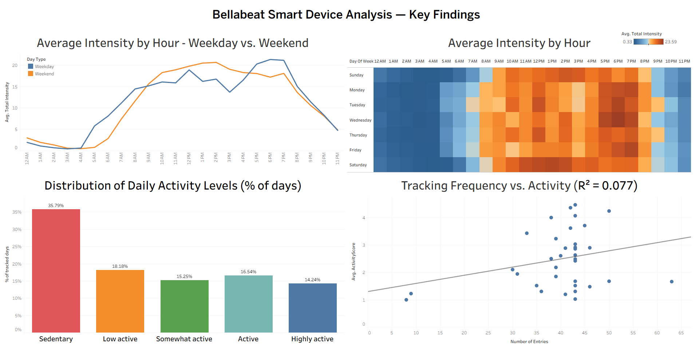

# Bellabeat Smart Device Analysis

This project analyzes Fitbit usage data from 30 users to identify behavioral patterns and deliver marketing recommendations for Bellabeat, a women's wellness tech company.



*[View the interactive dashboard on Tableau Public](https://public.tableau.com/app/profile/nathan.johnson6279/viz/BellabeatSmartDeviceAnalysis_17915911524350/Dashboard1)*

## The Business Problem

Bellabeat wants to understand how consumers use smart fitness devices to identify growth opportunities. The analysis focuses on answering: What are trends in smart device usage, and how can they inform Bellabeat's marketing strategy? [citation:8]

## Data Source

- **Source:** FitBit Fitness Tracker Data (public domain, available via Kaggle) [citation:4]
- **Scope:** 30 Fitbit users over two months (March–May 2016)
- **Data Files:** 18 CSV files containing minute-level physical activity, heart rate, and sleep monitoring data

## Methodology

- **Data Cleaning:** Consolidated and cleaned 18 CSV files in Google Sheets, addressing date formatting issues, duplicates, and missing data.
- **Analysis:** Used Tableau to explore temporal patterns, behavioral rhythms, activity level distribution, and engagement metrics.
- **Key Analytical Approach:** Categorized daily step counts into five activity levels (Sedentary to Highly Active) to segment user behavior.

## Key Insights

- **Weekly Activity Rhythm:** Users follow distinct weekday and weekend patterns. Weekday activity peaks in the late afternoon (5-6 PM); weekend activity peaks earlier in the day (11 AM - 1 PM).
- **Sedentary Dominance:** 35.79% of all tracked days fall into the Sedentary category, more than double any other activity level.
- **Tracking ≠ Activity:** Tracking frequency explains only 8% of the variance in activity level (R² = 0.077), challenging the assumption that engaged users are more active.

## Recommendations

1. **Day-aware notifications:** Adjust message timing based on observed weekday vs. weekend activity rhythms.
2. **Focus on sedentary reduction:** Shift marketing from "10,000 steps" to "break up your sitting time" to meet users where they are.
3. **Two-axis segmentation:** Segment users by both engagement and activity to create targeted campaigns.

## Tech Stack

- **Data Cleaning:** Google Sheets
- **Visualization:** Tableau
- **Report:** Google Docs / PDF

## Project Structure
```
├── data/           # Raw and cleaned data files
├── dashboards/     # Tableau workbook files (.twb/.twbx)
├── images/         # Dashboard screenshots and visual assets
├── report/         # Full written case study (PDF)
└── README.md
```

## What I'd Do Next

- Seek a larger, gender-disaggregated dataset to better address Bellabeat's target audience.
- Incorporate statistical testing to validate the significance of observed trends.
- Develop a prototype for the day-aware notification system recommendation.
